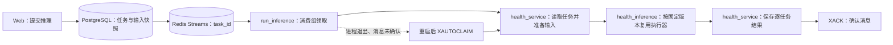

# 后端架构设计

## 目标与范围

本项目重新设计 `nxhe-backend` 的后端组织，不以复用旧数据库迁移、旧 URL 或旧模块目录为前提。采用 Django 项目的惯用组织方式，结合必要的领域规则与应用用例；不要求每张表都有独立的领域实体，也不按接口数量拆分文件。

系统由 Django 业务包 `health_service` 和与其平级的计算包 `health_inference` 组成。两者位于同一代码仓库；Web 从一开始通过 ASGI 提供异步 HTTP 接口，推理以独立的 Django 管理命令进程运行，不引入 Celery。Redis Streams 承担两进程之间的任务消息传递，本阶段不设计 Redis 本身的可用性保障。

## 包与目录

实际 workspace 目录如下。成员内部按职责组织；未展开的具体业务文件可继续按现有领域边界拆分。

```text
.
├── pyproject.toml                     # workspace 根：共享开发工具与检查配置
├── uv.lock                            # 两个成员共用的唯一锁文件
├── manage.py                          # 仓库级 Django 管理入口
└── packages/
    ├── health-service/
    │   ├── pyproject.toml             # Django 业务成员与运行依赖
    │   └── src/
    │       ├── config/                # Django ASGI 配置、URL 与设置
    │       └── health_service/        # Django App：业务与持久化
    │           ├── models/
    │           ├── migrations/
    │           ├── domain/
    │           ├── application/
    │           ├── schemas/
    │           ├── api/
    │           ├── infrastructure/
    │           └── management/commands/
    │               └── run_inference.py # 独立消费者入口
    └── health-inference/
        ├── pyproject.toml             # 纯计算成员，无第三方运行依赖
        └── src/health_inference/
            ├── types.py               # 计算过程的数据类型
            ├── registry.py            # 受控算法注册
            └── algorithms/            # 可执行算法
```

### uv workspace 与依赖归属

根目录 `pyproject.toml` 只显式编排 `health-service` 和 `health-inference`，不形成第三个业务项目；Python 基线为 3.13，成员共用根目录的 `uv.lock` 和默认 `.venv`。`health-service` 包含 Django `health_service` 与 `config`，声明所有业务运行依赖（包括直接使用的 `asgiref`），并显式依赖本地 `health-inference`；`health-inference` 不依赖业务成员，当前不声明第三方运行依赖。

```sh
# 完整开发与测试环境
uv sync --locked --all-packages
# 仅业务成员及其运行依赖
uv sync --locked --package health-service --no-dev
# 仅计算成员及其运行依赖
uv sync --locked --package health-inference --no-dev
```

服务和管理命令从仓库根目录通过 `uv run --locked --package health-service ...` 执行；`--package` 选择依赖环境，不代替工作目录切换。业务模块从已安装的 workspace 成员导入，无需额外源码搜索路径。

### 职责与依赖

- `health_service.models` 集中管理 Django ORM 模型、关系和迁移，按账号、渠道、模型目录和推理任务分文件。账号持有当前健康资料；推理任务持有当次计算所需的资料快照和结果。
- `health_service.domain` 只表达值得独立维护的业务规则，例如任务状态及渠道模型使用资格；不逐表复制 ORM 模型，也不依赖 Django、HTTP 或算法实现。
- `health_service.application` 编排注册登录、模型管理和推理任务等流程，可务实使用 Django 的认证和事务能力，但不依赖 `api`。简单查询不必为满足分层而增加通用仓储接口。
- `health_service.api` 负责渠道与版本装配、请求绑定、响应输出及入口权限。`infrastructure` 实现 ORM、Redis、短信、存储和计算调用等技术细节；Django 模型保留在 App 可发现的 `models/` 包中。
- `health_inference` 持有算法和模型运行时，只接收计算所需输入并返回结果；不导入 Django ORM、HTTP Schema 或 `health_service` 的业务代码。需要跨包转换时由 `health_service.infrastructure.inference_adapter` 完成。

### 推理算法契约与身份字段

`health_inference` 通过代码显式注册的稳定 `algorithm_key` 提供可执行定义及参数、结果校验；数据库只保存算法标识和版本参数，不增加 `input_spec` 字段，也不允许从数据库动态导入类路径。`health_service.infrastructure.inference_adapter` 将固定版本、选中文件和提交快照转换为纯计算输入，不让算法访问 ORM、HTTP 或实时资料。

正式算法 `ppg.active.offline.hr_br.v1` 接受单块 `ppg` 输入并返回 HR、BR 与实际质量分数；无必需制品或健康资料，固定参数必须为空，指标单位分别为 `beats_per_minute` 和 `breaths_per_minute`。通用 `isExample` 字段由算法定义决定，模型名称和客户端参数不能改变该身份；正式 PPG v1 返回 `false`。

## 六大渠道与 API

业务接入渠道的 label 暂定为 `android-cn`、`android-intl`、`ios-cn`、`ios-intl`、`wxapp`、`manager`。此处的渠道 label 与 Django `AppConfig.label` 是不同概念；代码中使用 `ChannelLabel` 等明确名称区分。

新 API 建议采用 `/api/v1/<channel>/...`。路由指定预期渠道，认证得到的渠道必须与之匹配；同一行为复用 HTTP handler、Schema 和应用用例，确有差异时才增加渠道专用适配。`manager` 除渠道识别外，还必须校验登录人员的管理权限。渠道标识或移动端内置密钥不能代替用户身份认证与任务归属校验。

API 版本决定 HTTP 请求和响应契约；移动 App 发布版本、模型版本和渠道 label 分别管理。模型目录在 `manager` 权限下创建模型和未发布版本；只有代码显式注册的算法可发布，发布事务在版本行锁内校验固定参数、与算法声明完全一致且物理文件存在的制品集合，以及代码、值类型和单位都匹配的投影指标。正式 `ppg.active.offline.hr_br.v1` 可在空制品、空参数及匹配 HR/BR 指标契约时发布。版本发布后执行配置不可原地修改，重复发布不改变首次发布时间。

每个已知渠道独立选择一个属于目标模型的已发布版本。选择事务依次锁渠道行、选择行和旧版本 `DRAFT` 任务行，并原子更新选择、终止旧草稿；同版本重选不改任务，已提交或运行中的任务继续使用固定版本，回退不会复活已失败草稿。普通渠道目录只返回自身当前发布版本、所需输入逻辑名和 `isExample`，不暴露参数或文件路径。

### 双 Token 认证

对外 API 不再通过 Django Session 识别用户。密码登录或短信登录验证成功后，签发短期 Access Token 和可轮换的 Refresh Token；业务请求使用 `Authorization: Bearer` 携带 Access Token，刷新令牌只用于专用刷新和登出流程。优先评估 `django-ninja-jwt` 的异步鉴权及刷新令牌黑名单功能，锁定依赖前验证与 Django、Django Ninja Extra 的兼容性；登录入口仍需自行处理短信验证、渠道和管理端权限，不直接暴露绕过这些约束的默认登录接口。

令牌绑定用户和渠道；鉴权还需核对用户是否可用、管理人员权限及业务资源归属。刷新时轮换并撤销旧 Refresh Token，登出时撤销当前 Refresh Token；此前签发的 Access Token 可能在其短暂有效期内继续有效，若要求立即失效须另行设计。旧 Session 不能自动当作新令牌，客户端需要适配令牌的保存、携带与刷新，并重新登录。

## Schema 与数据边界

`health_service.schemas` 与 `api`、`application` 平级：`api` 和 `application` 可以复用 Schema，`application` 不从 `api` 导入类型，`domain` 不依赖 Schema。根据用途区分：

- `requests/`：使用 Pydantic／Django Ninja Schema 校验外部输入；按需使用 `validation_alias`。JSON、Form 和文件上传的绑定方式由 API 路由决定。
- `responses/`：校验应用结果并序列化对外字段；按需使用 `serialization_alias`，路由应明确声明响应 Schema 并正确配置 `by_alias=True`。管理端与普通用户的可见字段分别定义。
- `internal/`：应用用例、持久化与计算适配之间传递规范化输入、任务快照和结果；使用内部字段名，不携带 HTTP 别名或 Django `Request`、ORM 实例。

输入契约与用例输入完全一致时可直接复用，不强制增加一份内部 DTO；API 版本或渠道契约出现实际差异时，再在 HTTP 边界转换成稳定的内部数据。第三方短信服务的协议类型留在 `infrastructure/sms/`。计算中间数组等类型归 `health_inference` 管理，不通过业务 DTO 做不必要的复制。

### 账号注册持久化边界

账号注册用例在 `application.accounts.register_user` 中完成用户名规范化、Django 字段与密码校验，并持有账号及空资料创建的同一个 `transaction.atomic()`。事务内调用具体持久化函数执行 ORM 操作；`accounts.create_account` 只将 PostgreSQL 用户名唯一约束冲突映射为专用持久化异常，其他数据库错误原样传播，应用层在事务回滚后转换为稳定的用户名冲突。

注册结果使用已求值的 `AccountSummary`，仅包含账号 ID 与用户名；资料持久化返回 `ProfileData`。应用层和 API 不接收 ORM 模型或惰性查询结果，读取内部结果字段不再访问数据库。认证和密码能力仍使用 Django，不引入通用仓储或额外事务抽象。

### 资料读取与更新事务边界

资料读取由具体持久化函数返回 `ProfileData` 或 `None`，缺失读取不创建记录。资料更新用例在一个同步事务中先锁账号行，再锁定并读取资料；应用层按字段白名单合并标量与病史更改，缺失资料只在存在实际更改时创建，已有资料只定向更新提交字段。

持久化更新显式维护 `updated_at`，不改写 `created_at` 或未涉及的操作人字段。空更改集不创建或更新资料；读取和更新结果均为已求值的 `ProfileData`，API 不持有 ORM 模型。

## 异步 Web 与事务

Web 使用 ASGI、Django Ninja Extra 的异步控制器，并避免在事件循环内直接执行 CPU 推理或阻塞文件操作。Django 的异步 ORM 可处理部分查询，但事务流程仍封装为同步函数，由异步入口通过 `sync_to_async` 调用；同步中间件和同步依赖也应避免使异步请求长期占用线程。

## 推理任务与资料快照边界

任务所有权同时绑定有效 Access 的账号和来源渠道。普通用户只能用 `modelId` 创建 `DRAFT`；服务从该渠道当前选择读取已发布版本，并在任务中固定模型版本，不接受客户端指定用户或版本。创建草稿不冻结资料，也不设置提交时间。

输入上传只允许本人当前渠道的草稿及算法声明的逻辑名。应用在任务行锁内分块写入完整文件，再登记新的 `TaskInputFile` 并切换同名选中关系；并发上传串行，历史记录和文件保留。最终提交与版本切换共用“渠道行 → 当前版本选择行 → 任务行”锁顺序；输入上传只锁任务行，不反向获取渠道锁。提交之后再按既有“用户行 → 资料行”顺序取锁，避免与资料更新形成反向依赖。

提交重检版本仍为当前选择、必需输入均已选中且物理文件可读，然后在同一事务保存完整资料快照、提交时间和提交日周岁并转为 `SUBMITTED`。快照明确保存 `birth_date`、`age_years`、`height_cm`、`weight_kg`、姓名、性别、文字病史与原样 `history_json`；身高和体重分别使用 cm、kg，缺失值和缺席病史键不补默认值。缺失资料只产生内部空快照，不创建 `Profile`。上传与提交不解析算法内容；执行时只按固定版本的 `required_profile_fields` 校验算法资料。

任务列表仅查询稳定倒序摘要字段，不载入快照、完整结果或失败诊断。详情读取任务保存的权威完整结果；不重算算法、不从 `TaskMetric` 反向拼装。普通用户失败详情只见固定安全代码和摘要；快照、`failure_detail`、原始输入及服务器路径不进入普通响应。提交后的消息发布位于数据库事务提交之后，Redis 故障不能撤回已提交状态。

## 本地文件存储

原始健康数据与模型制品分别使用可配置的本地根目录。数据库保存相对路径或存储键，Web 与独立推理进程须能按各自配置访问同一批文件；路径权限由部署配置保证。原始健康数据目录不作为公开静态目录，下载须校验用户身份与任务归属。当前不引入对象存储。

## Redis Streams 与常驻推理



Web 在任务数据库事务提交后发布仅包含任务标识的消息，不复制原始健康数据。数据库是任务与结果的权威来源，Redis 不保存结果副本；提交成功后遇到 Redis 连接故障仍保持 `SUBMITTED`，由数据库扫描重新派发。

数据库补偿扫描按主键稳定排序，每批最多读取 100 个任务，覆盖未成功发布或超过补发间隔的 `SUBMITTED`，以及租约已过期的 `RUNNING`。只有 `XADD` 成功后才条件记录 `last_dispatched_at`；发布后补记失败允许重复消息。过期 `RUNNING` 即使没有原 Stream 条目也可重新派发。扫描不清空共享 Redis，不承诺消息恰好一次或 Redis 高可用。

消费组用 `XREADGROUP` 领取消息，并在数据库确认任务已终结或消息不可执行后才 `XACK`；执行权仍由数据库令牌和租约决定，不由 Stream 所有权决定。未确认消息可由 `XAUTOCLAIM` 重领，重领不等于取得执行权；有效租约任务不得重复执行或确认，终态消息只确认而不改写结果。Stream 不自动裁剪或清空，避免删除仍需恢复的条目。

租约领取在 PostgreSQL 行锁内使用数据库时间，只接受 `SUBMITTED` 或已过期 `RUNNING`；每次有效领取创建新 `execution_token`、增加一次 `attempt_count`，并保留首次 `started_at`。续约要求令牌匹配且租约仍有效，迟到心跳不能恢复过期执行权。执行次数达到配置上限且租约过期后，以 `TASK.RETRY_EXHAUSTED` 和安全摘要终结；暂时数据库或 Redis 异常不直接转换为算法失败。

适配器按任务固定的模型版本复用受控执行器、不可变参数和制品引用，不读取渠道当前选择或实时健康资料。输入、资料快照和输出目录属于单次任务；输出目录按任务 ID 与执行令牌隔离。渠道切换不改变已提交任务的版本，清理进程内版本缓存不删除模型制品。初期逐任务执行，不实现请求合批。

## 技术选型

- 语言与依赖：Python 3.13、`uv` 和单一锁文件；Web 与推理依赖分开声明，具体算法依赖按需纳入推理安装项。
- Web：Django 5.2 LTS、Django Ninja、Django Ninja Extra、Pydantic v2，以 ASGI 和 Uvicorn 运行异步 API。
- 认证：Django 用户和密码能力、Access Token 与 Refresh Token；优先评估 `django-ninja-jwt` 的异步鉴权及刷新令牌轮换、黑名单，具体依赖版本需验证后锁定。Redis 不承担用户 Session 鉴权。
- 数据库：PostgreSQL、Django ORM、`psycopg` 3，保存任务归属、输入快照、状态与结果。
- 队列：`redis-py` 操作 Redis Streams 消费组；Web 异步发布任务标识，独立推理进程消费并确认。Redis 若另有明确需要，可承担缓存，但不存放任务结果的权威副本。
- 文件与推理：可配置的本地文件目录；CPU 版 ONNX Runtime 及实际算法需要的信号处理依赖仅由推理进程加载，Web 不预加载模型。
- 开发验证：`pytest`、`pytest-django` 和 `ruff`；重点验证双 Token、任务状态、消息重领及文件访问的实际行为。

## 后续单独设计的事项

以下内容不属于当前变更已确定的实现范围：

- 正式 HR/BR v1 的独立医学准确性验证；当前实现迁移旧数值链并通过合成信号行为验证，不构成医学准确性认证。
- 任务取消、草稿过期、历史健康数据删除与文件自动清理。
- 多进程扩容、请求合批、正式模型资源加载策略，以及 Redis 高可用。
- 各渠道客户端的密钥保管政策和是否立即撤销 Access Token。

数据库扫描和租约降低任务静默遗失与旧执行覆盖结果的风险，但不保证恰好一次执行，也不提供 Redis 可用性保证。
