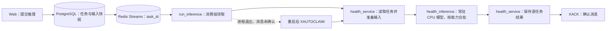

# 后端架构设计

## 目标与范围

本项目重新设计 `nxhe-backend` 的后端组织，不以复用旧数据库迁移、旧 URL 或旧模块目录为前提。采用 Django 项目的惯用组织方式，结合必要的领域规则与应用用例；不要求每张表都有独立的领域实体，也不按接口数量拆分文件。

系统由 Django 业务包 `health_service` 和与其平级的计算包 `health_inference` 组成。两者位于同一代码仓库；Web 从一开始通过 ASGI 提供异步 HTTP 接口，推理以独立的 Django 管理命令进程运行，不引入 Celery。Redis Streams 承担两进程之间的任务消息传递，本阶段不设计 Redis 本身的可用性保障。

## 包与目录

以下展示职责和建议位置，不要求预先创建所有文件；相关代码可先按职责合并，复杂后再拆分。

```text
src/
├── config/                           # Django ASGI 配置与 URL
├── health_service/                   # Django App：业务与持久化
│   ├── apps.py
│   ├── models/                        # 按账号、渠道、模型目录、infer 分文件
│   ├── migrations/
│   ├── domain/                        # 确有必要的业务规则
│   ├── application/                   # 注册登录、模型管理、提交推理等用例
│   ├── schemas/
│   │   ├── requests/                  # 外部入站契约
│   │   ├── responses/                 # 对外响应契约
│   │   └── internal/                  # 应用流程内部交换的数据
│   ├── api/v1/                        # 渠道、版本的异步 HTTP 适配
│   ├── infrastructure/
│   │   ├── persistence/               # ORM 查询及持久化实现
│   │   ├── auth/                      # Django 身份验证与双 Token 适配
│   │   ├── redis_queue/               # Redis Streams 发布、消费与确认
│   │   ├── sms/                       # 短信服务适配
│   │   ├── storage/                   # 可配置的本地原始数据和模型制品存储
│   │   └── inference_adapter.py       # 业务任务与计算输入输出转换
│   └── management/commands/
│       └── run_inference.py           # 独立推理进程入口
└── health_inference/                  # 普通 Python 计算包，非 Django App
    ├── runtime.py                     # 常驻模型实例
    ├── batching.py                    # 请求聚合与批量执行
    ├── types.py                       # 计算过程的数据类型
    └── algorithms/                    # 具体算法
```

### 职责与依赖

- `health_service.models` 集中管理 Django ORM 模型、关系和迁移，按账号、渠道、模型目录和推理任务分文件。账号持有当前健康资料；推理任务持有当次计算所需的资料快照和结果。
- `health_service.domain` 只表达值得独立维护的业务规则，例如任务状态及渠道模型使用资格；不逐表复制 ORM 模型，也不依赖 Django、HTTP 或算法实现。
- `health_service.application` 编排注册登录、模型管理和推理任务等流程，可务实使用 Django 的认证和事务能力，但不依赖 `api`。简单查询不必为满足分层而增加通用仓储接口。
- `health_service.api` 负责渠道与版本装配、请求绑定、响应输出及入口权限。`infrastructure` 实现 ORM、Redis、短信、存储和计算调用等技术细节；Django 模型保留在 App 可发现的 `models/` 包中。
- `health_inference` 持有算法和模型运行时，只接收计算所需输入并返回结果；不导入 Django ORM、HTTP Schema 或 `health_service` 的业务代码。需要跨包转换时由 `health_service.infrastructure.inference_adapter` 完成。

## 六大渠道与 API

业务接入渠道的 label 暂定为 `android-cn`、`android-intl`、`ios-cn`、`ios-intl`、`wxapp`、`manager`。此处的渠道 label 与 Django `AppConfig.label` 是不同概念；代码中使用 `ChannelLabel` 等明确名称区分。

新 API 建议采用 `/api/v1/<channel>/...`。路由指定预期渠道，认证得到的渠道必须与之匹配；同一行为复用 HTTP handler、Schema 和应用用例，确有差异时才增加渠道专用适配。`manager` 除渠道识别外，还必须校验登录人员的管理权限。渠道标识或移动端内置密钥不能代替用户身份认证与任务归属校验。

API 版本决定 HTTP 请求和响应契约；移动 App 发布版本与模型版本分别管理，不与渠道 label 混用。模型版本由模型目录确定，推理任务记录执行所需的确定信息；渠道独立选择当前版本、任务固定版本及回退的数据关系见[数据库设计](database-design.md)，模型实例的完整运行策略留待后续设计。

### 双 Token 认证

对外 API 不再通过 Django Session 识别用户。密码登录或短信登录验证成功后，签发短期 Access Token 和可轮换的 Refresh Token；业务请求使用 `Authorization: Bearer` 携带 Access Token，刷新令牌只用于专用刷新和登出流程。优先评估 `django-ninja-jwt` 的异步鉴权及刷新令牌黑名单功能，锁定依赖前验证与 Django、Django Ninja Extra 的兼容性；登录入口仍需自行处理短信验证、渠道和管理端权限，不直接暴露绕过这些约束的默认登录接口。

令牌绑定用户和渠道；鉴权还需核对用户是否可用、管理人员权限及业务资源归属。刷新时轮换并撤销旧 Refresh Token，登出时撤销当前 Refresh Token；此前签发的 Access Token 可能在其短暂有效期内继续有效，若要求立即失效须另行设计。旧 Session 不能自动当作新令牌，客户端需要适配令牌的保存、携带与刷新，并重新登录。

## Schema 与数据边界

`health_service.schemas` 与 `api`、`application` 平级：`api` 和 `application` 可以复用 Schema，`application` 不从 `api` 导入类型，`domain` 不依赖 Schema。根据用途区分：

- `requests/`：使用 Pydantic／Django Ninja Schema 校验外部输入；按需使用 `validation_alias`。JSON、Form 和文件上传的绑定方式由 API 路由决定。
- `responses/`：校验应用结果并序列化对外字段；按需使用 `serialization_alias`，路由应明确声明响应 Schema 并正确配置 `by_alias=True`。管理端与普通用户的可见字段分别定义。
- `internal/`：应用用例、持久化与计算适配之间传递规范化输入、任务快照和结果；使用内部字段名，不携带 HTTP 别名或 Django `Request`、ORM 实例。

输入契约与用例输入完全一致时可直接复用，不强制增加一份内部 DTO；API 版本或渠道契约出现实际差异时，再在 HTTP 边界转换成稳定的内部数据。第三方短信服务的协议类型留在 `infrastructure/sms/`。计算中间数组等类型归 `health_inference` 管理，不通过业务 DTO 做不必要的复制。

## 异步 Web 与事务

Web 使用 ASGI、Django Ninja Extra 的异步控制器，并避免在事件循环内直接执行 CPU 推理或阻塞文件操作。Django 的异步 ORM 可处理部分查询，但事务流程仍封装为同步函数，由异步入口通过 `sync_to_async` 调用；同步中间件和同步依赖也应避免使异步请求长期占用线程。

## 本地文件存储

原始健康数据与模型制品分别使用可配置的本地根目录。数据库保存相对路径或存储键，Web 与独立推理进程须能按各自配置访问同一批文件；路径权限由部署配置保证。原始健康数据目录不作为公开静态目录，下载须校验用户身份与任务归属。当前不引入对象存储。

## Redis Streams 与常驻推理



Web 在任务数据库提交后向 Stream 发布仅包含任务标识的消息，不复制原始健康数据。`run_inference` 作为独立 Django 命令使用消费组领取消息，通过 `health_service` 读取任务、准备输入和保存结果，再经适配器调用纯计算包。API 从 PostgreSQL 查询任务状态与结果，当前不另设 Redis 结果队列。

消费组用 `XREADGROUP` 领取消息；结果或可确认的任务终态持久化后才用 `XACK` 确认。进程退出留下的未确认消息须由重启后的消费者用 `XAUTOCLAIM` 重领。重复投递可能发生：已保存结果但未确认的消息应确认而不重复写入；崩溃留下的 `RUNNING` 任务不能直接跳过，须有可恢复的状态规则。`XACK` 不删除 Stream 条目，后续清理不能丢弃仍需重领的消息。

PostgreSQL 提交与 Redis `XADD` 不是同一事务；即使在 `transaction.on_commit()` 中发布，也仍存在数据库已提交而消息未发布的空档。事务 Outbox 或数据库补偿扫描等方案及其保证留待单独设计，不将选用 Streams 等同于端到端不丢任务或恰好执行一次。

初期按一个管理命令进程考虑，使在用 CPU 模型实例在该进程内复用。若算法后端支持兼容请求的一次批量调用，再由 `health_inference` 收集并合批；不支持的算法仍复用模型实例逐条执行。模型实例只保存可复用资源，任务专属的文件路径、质量信息及输出保留在各自的执行数据中。多进程时每个进程会有自己的模型实例，不承诺全局只有一份。

## 技术选型

- 语言与依赖：Python 3.13、`uv` 和单一锁文件；Web 与推理依赖分开声明，具体算法依赖按需纳入推理安装项。
- Web：Django 5.2 LTS、Django Ninja、Django Ninja Extra、Pydantic v2，以 ASGI 和 Uvicorn 运行异步 API。
- 认证：Django 用户和密码能力、Access Token 与 Refresh Token；优先评估 `django-ninja-jwt` 的异步鉴权及刷新令牌轮换、黑名单，具体依赖版本需验证后锁定。Redis 不承担用户 Session 鉴权。
- 数据库：PostgreSQL、Django ORM、`psycopg` 3，保存任务归属、输入快照、状态与结果。
- 队列：`redis-py` 操作 Redis Streams 消费组；Web 异步发布任务标识，独立推理进程消费并确认。Redis 若另有明确需要，可承担缓存，但不存放任务结果的权威副本。
- 文件与推理：可配置的本地文件目录；CPU 版 ONNX Runtime 及实际算法需要的信号处理依赖仅由推理进程加载，Web 不预加载模型。
- 开发验证：`pytest`、`pytest-django` 和 `ruff`；重点验证双 Token、任务状态、消息重领及文件访问的实际行为。

## 后续单独设计的事项

以下事项不属于本阶段已经确定的实现方案：

- 任务中途失败、重试上限、`RUNNING` 状态恢复、未确认消息重领时长及 Stream 保留与清理策略；Redis 本身的可用性保障仍不属于本阶段。
- 文件上传完成、任务入队和任务领取之间的精确边界，以及数据库提交后 `XADD` 失败时的补偿方式。
- Access Token 与 Refresh Token 的有效期、各渠道客户端的安全保管方式及是否需要立即撤销 Access Token。
- 模型实例加载/卸载及异常恢复等完整运行策略；版本选择与切换的数据规则见[数据库设计](database-design.md)。
- 合批窗口、容量、并发进程数量以及其他业务参数。

这些细节确定前，不应将选用 Redis Streams 或当前流程图解读为已经实现端到端不丢任务、恰好执行一次或完整的失败恢复保证。
