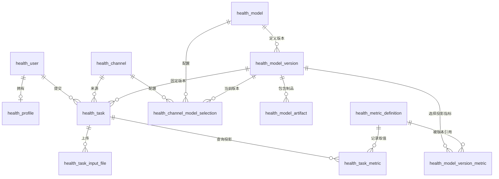

# 数据库设计

## 范围与命名

本文记录已确定的业务数据关系、当前 Django ORM 模型及其迁移对应的 PostgreSQL 物理结构；部署环境是否应用最新结构，以迁移状态为准。业务代码属于 Django App `health_service`；通过模型的 `Meta.db_table` 将业务表统一命名为 `health_*`，不修改 Django `AppConfig.label`。Django 自带的认证、权限表不在此命名范围内。

除共享主键的一对一关系外，主键使用 `BIGINT` 自增；时间使用带时区的 `TIMESTAMPTZ`，Django `JSONField` 在 PostgreSQL 中对应 `JSONB`。以下字段定义以当前模型和迁移为准，Django 用户的其他内置字段仍按框架定义。通用审计列单列说明，不在每张业务表的字段表中重复。模型输出结构按算法契约校验，不要求所有版本使用相同结构。

## ER 关系模型

`health_channel_model_selection`、`health_model_version_metric` 和 `health_task_metric` 是有业务字段或约束的关联表；`health_profile` 以用户 ID 为主键表达一对一。版本指标关联只定义可投影的指标，不定义完整输出；成功结果以 `health_task.result_payload` 为准。

## 通用抽象审计模型

`AuditModel` 是 Django 的抽象模型（`abstract = True`），自身不建物理表，也不定义主键，以便 `health_profile` 继续使用共享主键。本文的 12 张 `health_*` 业务表均继承它，因此每张物理表都包含以下列；ER 图不将抽象模型画作实体。

| 字段名 | 字段名称 | 字段类型 | 备注说明 |
|---|---|---|---|
| `created_at` | 创建时间 | `TIMESTAMPTZ` | 非空；记录首次入库时间，创建后不随业务修改变化。 |
| `updated_at` | 最近修改时间 | `TIMESTAMPTZ` | 非空；创建时与 `created_at` 一致，此后随实际修改更新。 |
| `created_by` | 创建操作人 | `VARCHAR(64)` | 可空；记录稳定标识快照，例如 `user:<id>` 或 `system:<component>`，不使用可变的用户名，不设置用户外键。 |
| `updated_by` | 最近修改操作人 | `VARCHAR(64)` | 可空；格式与 `created_by` 一致；无操作人上下文时允许为空。 |

审计模型不自动读取 HTTP 请求或推理进程上下文，操作人由应用用例写入；使用 `QuerySet.update()` 等批量更新任务状态时，也必须显式更新 `updated_at` 和 `updated_by`。这四列用于记录操作来源，不代替任务的提交、开始及结束等业务时间。

## 物理模型

以下逐表列出各表自身的关键字段，另包含上述四个审计列；`→` 表示外键指向的表和列。外键建议均为非空 `BIGINT`，其中 `health_profile.user_id` 同时是主键。各表的唯一约束与查询索引汇总在后文。

### `health_user`

| 字段名 | 字段名称 | 字段类型 | 备注说明 |
|---|---|---|---|
| `id` | 用户 ID | `BIGINT` | 自增主键。 |
| `username` | 用户名 | `VARCHAR(150)` | 非空，唯一。 |
| `password` | 密码哈希 | `VARCHAR(128)` | 非空；使用 Django 密码哈希，不存明文。 |
| `phone` | 手机号 | `VARCHAR(32)` | 可空；规范化后唯一，逻辑删除不释放。 |
| `is_active` | 账号可用状态 | `BOOLEAN` | 非空；逻辑删除时设为 `FALSE`。 |
| `is_staff` | 管理权限标记 | `BOOLEAN` | 非空；`manager` 渠道仍须校验管理权限。 |
| `deleted_at` | 逻辑删除时间 | `TIMESTAMPTZ` | 可空；保留用户和历史任务。 |

### `health_profile`

本表沿用旧项目的健康资料字段范围，允许用户逐步完善资料；结构化病史中除已明确的健康状态外，其他业务键仍待确定。

| 字段名 | 字段名称 | 字段类型 | 备注说明 |
|---|---|---|---|
| `user_id` | 用户 ID | `BIGINT` | 主键，外键 → `health_user.id`；与用户一对一。 |
| `name` | 姓名 | `VARCHAR(50)` | 可空；未填写时使用 `NULL`，不以空字符串代替。 |
| `gender` | 性别 | `SMALLINT` | 非空，默认 `0`；`0` 表示未知、`1` 表示男、`2` 表示女，不再用 `NULL` 表示未知。 |
| `birth_date` | 出生日期 | `DATE` | 可空；任务提交时按此计算当次年龄。 |
| `height_cm` | 身高 | `NUMERIC(5,2)` | 可空；单位 cm，有值时大于零；未知值使用 `NULL` 而不是 `0`。 |
| `weight_kg` | 体重 | `NUMERIC(6,2)` | 可空；单位 kg，有值时大于零；未知值使用 `NULL` 而不是 `0`。 |
| `medical_history` | 病史文字 | `TEXT` | 可空。 |
| `history_json` | 结构化病史 | `JSONB` | 可空；持久化和内部字段使用 `is_diabetic`、`is_hypertensive` 两个可选布尔键，缺席时不写 `null` 或 `false`。HTTP 仍使用 `isDiabetic`、`isHypertensive`，仅由 API 边界转换。此命名规则不改变表结构，也不要求数据迁移。 |

### `health_channel`

| 字段名 | 字段名称 | 字段类型 | 备注说明 |
|---|---|---|---|
| `id` | 渠道 ID | `BIGINT` | 自增主键。 |
| `label` | 渠道标识 | `VARCHAR(32)` | 非空，唯一；六大渠道为 `android-cn`、`android-intl`、`ios-cn`、`ios-intl`、`wxapp`、`manager`。 |

### `health_model`

| 字段名 | 字段名称 | 字段类型 | 备注说明 |
|---|---|---|---|
| `id` | 模型 ID | `BIGINT` | 自增主键；代表模型种类。 |
| `code` | 模型编码 | `VARCHAR(100)` | 非空，唯一。 |
| `name` | 模型名称 | `VARCHAR(255)` | 非空。 |
| `description` | 模型描述 | `TEXT` | 可空。 |

### `health_model_version`

| 字段名 | 字段名称 | 字段类型 | 备注说明 |
|---|---|---|---|
| `id` | 模型版本 ID | `BIGINT` | 自增主键。 |
| `model_id` | 所属模型 ID | `BIGINT` | 非空，外键 → `health_model.id`。 |
| `version` | 版本号 | `VARCHAR(64)` | 非空；与 `model_id` 联合唯一。 |
| `algorithm_key` | 算法标识 | `VARCHAR(255)` | 非空；用于定位对应算法。 |
| `params` | 模型参数 | `JSONB` | 可空；发布后不原地修改。 |
| `published_at` | 发布时间 | `TIMESTAMPTZ` | 可空；渠道仅选择已发布版本。 |

### `health_model_artifact`

| 字段名 | 字段名称 | 字段类型 | 备注说明 |
|---|---|---|---|
| `id` | 制品 ID | `BIGINT` | 自增主键。 |
| `model_version_id` | 所属模型版本 ID | `BIGINT` | 非空，外键 → `health_model_version.id`。 |
| `logical_name` | 制品逻辑名 | `VARCHAR(255)` | 非空；同版本内唯一。 |
| `storage_key` | 制品存储键 | `TEXT` | 非空，唯一；相对于模型制品根目录。 |
| `size_bytes` | 文件大小 | `BIGINT` | 非空且大于零，单位字节；卸载实例不删除制品。 |

### `health_channel_model_selection`

| 字段名 | 字段名称 | 字段类型 | 备注说明 |
|---|---|---|---|
| `id` | 渠道模型配置 ID | `BIGINT` | 自增主键。 |
| `channel_id` | 渠道 ID | `BIGINT` | 非空，外键 → `health_channel.id`。 |
| `model_id` | 模型 ID | `BIGINT` | 非空，外键 → `health_model.id`；与 `channel_id` 联合唯一。 |
| `current_version_id` | 当前模型版本 ID | `BIGINT` | 非空，外键 → `health_model_version.id`；应用用例校验其属于 `model_id` 且已发布。 |

### `health_metric_definition`

| 字段名 | 字段名称 | 字段类型 | 备注说明 |
|---|---|---|---|
| `id` | 指标定义 ID | `BIGINT` | 自增主键。 |
| `code` | 指标代码 | `VARCHAR(128)` | 非空，唯一；语义或单位变化时使用新代码。 |
| `description` | 指标含义 | `TEXT` | 可空；描述数值的业务含义。 |
| `value_type` | 指标值类型 | `VARCHAR(16)` | 非空；本阶段为数值或布尔值。 |
| `unit` | 指标单位 | `VARCHAR(32)` | 可空；布尔指标无需单位。 |

### `health_model_version_metric`

| 字段名 | 字段名称 | 字段类型 | 备注说明 |
|---|---|---|---|
| `id` | 版本指标关联 ID | `BIGINT` | 自增主键。 |
| `model_version_id` | 模型版本 ID | `BIGINT` | 非空，外键 → `health_model_version.id`。 |
| `metric_id` | 指标定义 ID | `BIGINT` | 非空，外键 → `health_metric_definition.id`；与 `model_version_id` 联合唯一，标记该版本可投影的指标，不要求每次结果都包含。 |

### `health_task`

| 字段名 | 字段名称 | 字段类型 | 备注说明 |
|---|---|---|---|
| `id` | 任务 ID | `BIGINT` | 自增主键。 |
| `user_id` | 归属用户 ID | `BIGINT` | 非空，外键 → `health_user.id`；账号逻辑删除后仍保留任务。 |
| `channel_id` | 来源渠道 ID | `BIGINT` | 非空，外键 → `health_channel.id`。 |
| `model_version_id` | 执行模型版本 ID | `BIGINT` | 非空，外键 → `health_model_version.id`；创建草稿时固定。 |
| `status` | 任务状态 | `VARCHAR(16)` | 非空，默认 `DRAFT`；状态转换见后文。 |
| `profile_snapshot` | 健康资料快照 | `JSONB` | 可空；最终提交时冻结计算所需资料。 |
| `submitted_at` | 提交时间 | `TIMESTAMPTZ` | 可空；草稿失败时仍为空。 |
| `started_at` | 开始执行时间 | `TIMESTAMPTZ` | 可空。 |
| `finished_at` | 结束时间 | `TIMESTAMPTZ` | 可空；成功或失败时记录。 |
| `result_payload` | 完整成功结果 | `JSONB` | 可空；仅 `SUCCEEDED` 时非空，以任务固定的模型版本解释并校验其结构，是结果详情的权威记录。 |
| `failure_code` | 失败代码 | `VARCHAR(64)` | 可空；`FAILED` 时非空，按 `TASK.*`、`INFERENCE.*`、`RESULT.*` 区分失败来源。 |
| `failure_message` | 失败摘要 | `TEXT` | 可空；可安全对外展示，不直接保存原始异常文本。 |
| `failure_detail` | 失败详情 | `JSONB` | 可空；保存结构化诊断信息，不保存原始健康数据或异常堆栈。 |
| `execution_token` | 当前执行令牌 | `UUID` | 可空；每次有效领取生成，只有 `RUNNING` 任务保留。 |
| `lease_expires_at` | 执行租约到期时间 | `TIMESTAMPTZ` | 可空；与执行令牌成对，仅运行中任务有值。 |
| `attempt_count` | 有效领取次数 | `INTEGER` | 非空，默认 `0`，不得小于零；只在有效领取时增加。 |
| `last_dispatched_at` | 最近成功发布时间 | `TIMESTAMPTZ` | 可空；仅在 Redis 消息发布成功后更新，终态可保留。 |

### `health_task_input_file`

| 字段名 | 字段名称 | 字段类型 | 备注说明 |
|---|---|---|---|
| `id` | 原始文件记录 ID | `BIGINT` | 自增主键；每次成功上传新增一行。 |
| `task_id` | 所属任务 ID | `BIGINT` | 非空，外键 → `health_task.id`。 |
| `logical_name` | 输入文件逻辑名 | `VARCHAR(255)` | 非空；同名可重传。 |
| `storage_key` | 原始文件存储键 | `TEXT` | 非空，唯一；相对于原始数据根目录。 |
| `size_bytes` | 文件大小 | `BIGINT` | 非空且大于零，单位字节。 |
| `uploaded_at` | 上传完成时间 | `TIMESTAMPTZ` | 非空。 |
| `is_selected` | 是否为当前输入 | `BOOLEAN` | 非空；同任务同逻辑名至多一行选中，未选中的旧文件仍保留。 |

### `health_task_metric`

| 字段名 | 字段名称 | 字段类型 | 备注说明 |
|---|---|---|---|
| `id` | 指标投影 ID | `BIGINT` | 自增主键。 |
| `task_id` | 所属任务 ID | `BIGINT` | 非空，外键 → `health_task.id`。 |
| `metric_id` | 指标定义 ID | `BIGINT` | 非空，外键 → `health_metric_definition.id`；与 `task_id` 联合唯一。 |
| `numeric_value` | 数值指标值 | `DOUBLE PRECISION` | 可空；与 `boolean_value` 恰好一个非空。 |
| `boolean_value` | 布尔指标值 | `BOOLEAN` | 可空；仅投影成功结果中可查询的指标，与数值列恰好一个非空。 |

### 唯一约束与查询索引

- `health_user.phone` 的唯一约束包含逻辑删除的账号，不以 `deleted_at IS NULL` 为条件；允许未绑定手机号的用户记录采用 `NULL`。`health_channel.label`、`health_model.code`、`health_metric_definition.code` 及制品、文件存储键分别唯一。
- `health_model_version(model_id, version)`、`health_channel_model_selection(channel_id, model_id)`、`health_model_version_metric(model_version_id, metric_id)` 和 `health_task_metric(task_id, metric_id)` 分别唯一。
- `health_profile.gender` 限制为 `0`、`1`、`2`；`height_cm`、`weight_kg` 为 `NULL` 或大于零，旧项目的 `0` 身高体重不能原样作为有效测量值导入。
- `health_task_input_file` 使用条件唯一约束 `(task_id, logical_name) WHERE is_selected = TRUE`；未选中的历史上传可以有多条。文件大小必须大于零，仅将已完整上传的文件登记为有效记录。
- `health_task` 使用检查约束保证仅 `SUCCEEDED` 状态的任务有非空 `result_payload`，且成功任务必须有结果；`health_task_metric.task_id` 的外键只能保证任务存在，指标行仅属于成功任务由同一事务中的用例保证。
- `health_task` 的执行租约约束要求 `RUNNING` 任务同时具有 `execution_token` 与 `lease_expires_at`，其他状态二者均为空；`attempt_count` 不得为负数。成功结果约束继续保证仅 `SUCCEEDED` 有 `result_payload`。
- 任务列表建议使用 `(user_id, created_at DESC)`；渠道切换时批量终止草稿建议使用 `(channel_id, model_version_id, status)`；判断某版本是否仍有已提交或执行中的任务建议使用 `(model_version_id, status)`。实际索引以查询量和执行计划验证后确定。
- 数值指标的范围筛选和排序建议使用 `health_task_metric(metric_id, numeric_value, task_id)`；布尔指标索引按实际查询负载决定。已知 `metric_id` 时，可直接通过 `task_id` 关联任务做归属、渠道和时间过滤，无需让常用统计查询经过版本指标关联表。结果详情读取 `health_task.result_payload`；任务列表只选摘要字段，不默认读取完整结果或对任意 JSON 路径建立索引。

## 写入与生命周期约束

### 账号、草稿和文件

账号删除采用逻辑删除：写入 `deleted_at`，并将 `is_active` 设为 `FALSE`。认证须检查账号可用状态；历史任务、资料快照及原始文件不随账号注销自动删除，手机号不能用于创建另一账号。业务数据的访问仍需校验任务归属和管理权限。

任务状态为 `DRAFT → SUBMITTED → RUNNING → SUCCEEDED/FAILED`，草稿也可能直接转为 `FAILED`。草稿不设置过期时间。每个文件通过独立请求上传；草稿中同名文件可重传，新上传记录被选中，旧记录和物理文件永久保留。已提交或失败的任务不允许再上传、替换或重新提交。上传及最终提交锁定任务行，避免提交与最后一次上传交错；文件写入与数据库事务不能视为一个原子操作。

最终提交时依据该版本的输入契约校验所需文件已被选中、渠道仍选择草稿固定的版本，再冻结当时所需的健康资料；年龄等随时间变化的输入以提交时的值进入快照。只有完成上述检查的任务转为 `SUBMITTED`。输入契约由版本元数据还是应用代码维护尚未确定。文件实际内容保存在可配置的本地目录，数据库仅保存相对存储键，不暴露原始文件为公开静态资源。

新增执行字段的迁移须在维护窗口停止旧消费者后执行。迁移会为旧 `RUNNING` 记录分别生成执行令牌并设置已过期租约，使其可由新消费者恢复；不改任务状态、`started_at`、资料快照或历史结果。迁移完成后再启动新消费者。

### 模型版本切换与回退

创建草稿时从 `health_channel_model_selection` 选定模型版本；渠道独立切换。切换该渠道的当前版本时，同一数据库事务将该渠道原版本的 `DRAFT` 任务标记为 `FAILED`，记录失败代码，不执行、不入队；这些草稿及原始文件保留。创建草稿、提交和切换使用一致的事务锁顺序，防止漏掉并发创建或提交的旧草稿。其他渠道仍可选择旧版本。

已经 `SUBMITTED` 或 `RUNNING` 的任务继续按自身固定的版本完成，模型新旧实例可以并存。旧版本没有渠道再指向且没有待执行或运行中的任务时，推理进程才卸载该版本实例；实例是否加载不写入数据库。渠道可以将当前版本指针切回仍保留制品的旧版本，必要时重新加载实例；此前已失败的草稿不会恢复。崩溃留下的 `RUNNING` 如何判定为可安全排空，仍依赖后续任务恢复设计。

### 失败代码与详情

任务进入 `FAILED` 时，同一事务写入 `finished_at` 和 `failure_code`，可附 `failure_message`、`failure_detail`；非失败任务不保留失败字段。代码按来源区分，例如草稿因版本切换终止使用 `TASK.MODEL_SWITCHED`，质检不通过使用 `INFERENCE.QUALITY_REJECTED`，模型输出无法按结果契约解释使用 `RESULT.INVALID_OUTPUT`。即使在草稿阶段失败，也只记录任务失败，`result_payload` 保持为空且不写指标投影行。

`failure_detail` 可记录质检分数、阈值或输出校验问题等结构化诊断；对外只返回允许公开的字段，不暴露堆栈、原始健康数据及本地绝对路径。数据库或 Redis 等暂时性故障不能仅因抛出异常就记成终态 `FAILED`；重试与恢复规则仍需单独设计。

### 成功结果与查询投影

任务成功时，`health_task.result_payload` 保存该次预测的完整结构化输出，以任务固定的模型版本及对应算法规则校验；不同模型和版本可以有不同结构。结果详情直接读取该字段，不从指标行反向组装，也不重新执行模型。对外响应按 API 契约转换，不将存储结构直接当作统一的 HTTP Schema。

`health_model_version_metric` 只选择该版本需要支持筛选和统计的稳定指标，算法适配器从结果中提取实际存在的可投影值，按 `health_metric_definition` 校验类型和语义。`health_task_metric` 只保存这些值；未产生的指标不写行，不以零代替，也不要求指标集合覆盖全部输出。数据库保证外键、单项唯一及数值/布尔列互斥；`result_payload`、指标投影与任务的 `SUCCEEDED` 状态在同一事务中写入，成功后不分别修改，避免重复数据不一致。指标语义或单位变化时使用新的代码，不能混合统计。

输出中如有处理后文件，应保存受保护的相对存储键而不是绝对路径或公开 URL；逐窗口数组等较大内容是否直接存入 `result_payload`、改存文件，仍需按实际规模和业务访问需求确定。

## 尚未纳入本模型的事项

- 结构化病史后续可增加的业务键、各模型所需文件和资料的输入契约归属、各模型具体输出校验规则及较大结果的存储方式，以及反馈、移动 App 发布版本等附属表，需按业务契约另定。
- 双 Token 所需的黑名单等数据结构取决于最终选用并验证兼容性的认证库，不预先设计平行的 Session 或自建令牌表。
- 本阶段不增加草稿过期字段或事务 Outbox；数据库提交与 Redis 发布之间的可靠投递、失败重试和 `RUNNING` 恢复仍按[后端架构设计](backend-architecture.md)留待单独设计。
